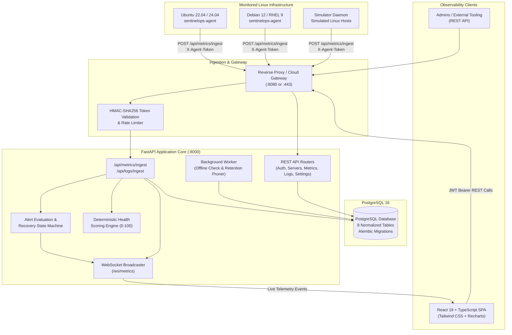
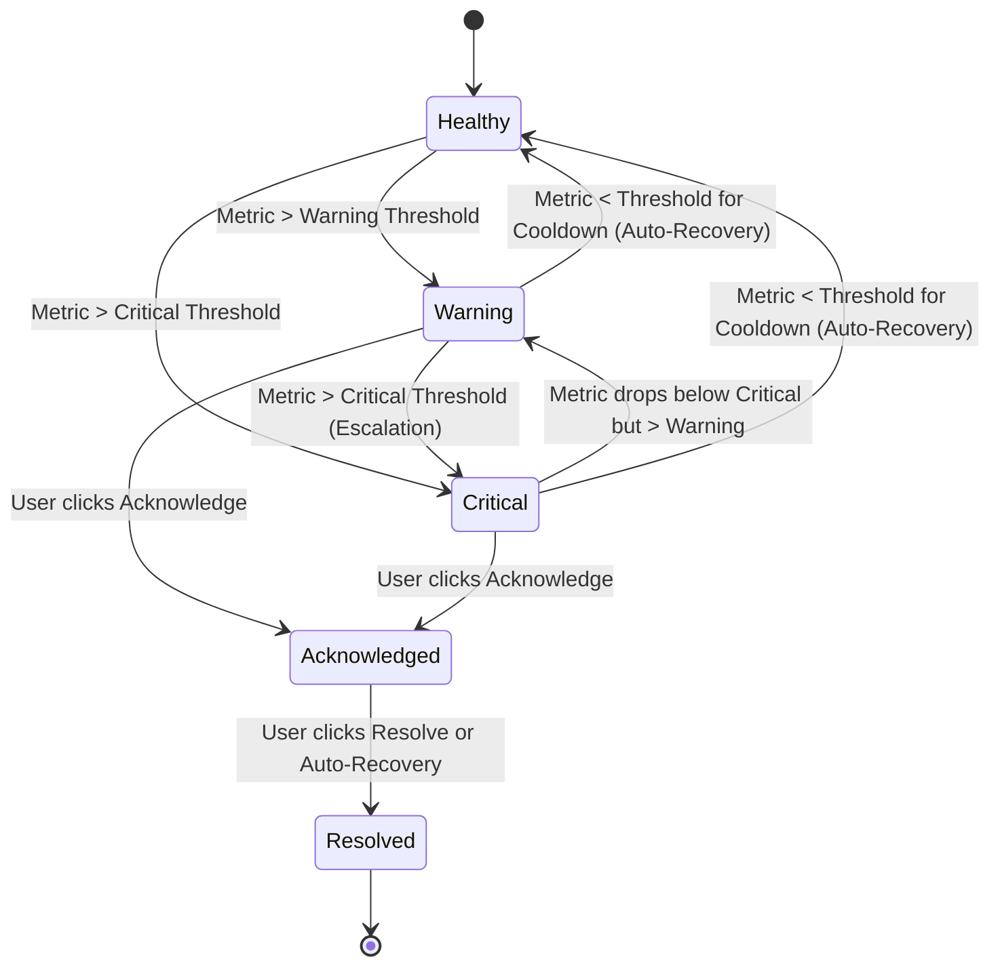

# SentinelOps

### Linux Server Monitoring, Fleet Observability and Alerting Platform

[Live Demo](https://sentinelops-xp4p.onrender.com) | [Architecture Documentation](docs/ARCHITECTURE.md) | [API Reference](docs/API_REFERENCE.md) | [Database Schema](docs/DATABASE_SCHEMA.md) | [Agent Workflow](docs/AGENT_WORKFLOW.md)

SentinelOps is an infrastructure monitoring and observability platform engineered for distributed Linux fleets. Built on a modular, decoupled architecture, it pairs a lightweight, non-privileged Python collection daemon with a high-throughput FastAPI ingestion backend, PostgreSQL 16 persistence layer, and a React 19 single-page application.

---

## Live Deployment

SentinelOps is deployed and operational on Render Cloud:

| Property | Value |
| :--- | :--- |
| **Platform URL** | [https://sentinelops-xp4p.onrender.com](https://sentinelops-xp4p.onrender.com) |
| **Fleet State** | Multi-server Linux telemetry and log streaming active |
| **Authentication** | JWT Bearer session with Role-Based Access Control |

---

## Table of Contents

- [1. Executive Summary](#1-executive-summary)
- [2. Problem Statement and Solution](#2-problem-statement-and-solution)
- [3. Key Platform Capabilities](#3-key-platform-capabilities)
- [4. High-Level Architecture](#4-high-level-architecture)
- [5. System Components and Technology Stack](#5-system-components-and-technology-stack)
- [6. Security and Hardening Model](#6-security-and-hardening-model)
- [7. Deterministic Server Health Scoring](#7-deterministic-server-health-scoring)
- [8. Intelligent Alert Lifecycle Engine](#8-intelligent-alert-lifecycle-engine)
- [9. Database Architecture](#9-database-architecture)
- [10. REST API and WebSocket Specifications](#10-rest-api-and-websocket-specifications)
- [11. Quickstart and Deployment Options](#11-quickstart-and-deployment-options)
  - [A. Cloud Blueprint Deployment](#a-cloud-blueprint-deployment)
  - [B. Local One-Command Launcher](#b-local-one-command-launcher)
  - [C. Docker Compose](#c-docker-compose)
  - [D. Ubuntu Linux Agent Installation](#d-ubuntu-linux-agent-installation)
- [12. Testing and Quality Assurance](#12-testing-and-quality-assurance)
- [13. Project Structure](#13-project-structure)
- [14. Production Readiness and Roadmap](#14-production-readiness-and-roadmap)
- [License](#license)

---

## 1. Executive Summary

SentinelOps enables systems engineers and infrastructure teams to monitor multiple Linux servers from a unified observability dashboard. Lightweight Python monitoring agents run on each host under least-privilege Linux permissions, collect real OS metrics and system logs, and stream them via authenticated HTTP requests to a central FastAPI backend backed by PostgreSQL and real-time WebSocket broadcasting.

The platform addresses real-world systems engineering requirements: non-privileged daemon execution, rate-of-change network bandwidth calculations, transparent deterministic health scoring, anti-flapping alert deduplication, and bidirectional WebSocket updates.

---

## 2. Problem Statement and Solution

| Operational Challenge | How SentinelOps Solves It |
| :--- | :--- |
| **Fragmented Fleet Visibility** | Centralizes multi-server CPU, memory, partition-level disk, and network metrics into a single real-time dashboard. |
| **Alert Notification Storms** | Implements an alert engine with configurable warning/critical thresholds, deduplication, cooldown intervals, and automatic recovery detection. |
| **Misinterpreted Network Counters** | Strictly separates cumulative byte/packet counters from calculated delta throughput (`Bytes/sec` and `Mbps`). |
| **Opaque Health Scores** | Computes a transparent 0 to 100 Health Score with deterministic mathematical deduction rules and plain-English factor explanations. |
| **Scattered Host Logs** | Ingests and indexes `/var/log/syslog`, `/var/log/auth.log`, and `journalctl` with keyword search and severity filtering without root-level exploitation. |
| **Security Risks with Remote Management** | Implements HMAC-SHA256 agent authentication, bcrypt password hashing, and role-based access control (Admin vs Viewer), while keeping process termination strictly disabled. |

---

## 3. Key Platform Capabilities

| Module | Core Capabilities |
| :--- | :--- |
| **Telemetry Core** | Per-core and aggregate CPU %, memory breakdown, partition-level disk utilization, network throughput calculation, load averages (1m, 5m, 15m), and uptime tracking. |
| **Alert Engine** | Warning and critical threshold evaluation, automatic escalation, cooldown windows, deduplication, and automated recovery detection. |
| **Log Explorer** | Read-only syslog, auth.log, and journald parsing with full-text keyword search, severity filtering, and error/warning highlighting. |
| **Security & RBAC** | Per-host HMAC-SHA256 token verification, JWT Bearer sessions, Admin vs Viewer roles, non-root daemon execution, and rate limiting. |
| **Health Scoring** | Mathematical 0 to 100 scoring engine with transparent deduction factors displayed per host. |
| **Process Inspection** | Read-only running process snapshots (PID, user, status, CPU %, memory %) with client-side sorting and search. Process termination is disabled by design. |
| **Dual Operation Modes** | Mode A for physical/virtual Linux servers; Mode B for multi-host simulation streaming demo telemetry. |

---

## 4. High-Level Architecture



---

## 5. System Components and Technology Stack

### Backend API Server
- **Framework**: FastAPI (Python 3.11+) with ASGI server Uvicorn.
- **Validation**: Pydantic v2 with strict schemas and input sanitization.
- **ORM & Database**: SQLAlchemy 2.0 with Alembic migrations and PostgreSQL 16 driver (`psycopg`).
- **Authentication**: JWT access tokens (HMAC-SHA256 via PyJWT), password hashing via bcrypt, and per-server agent API tokens hashed with SHA-256.
- **Real-Time Layer**: Asynchronous WebSockets with topic multiplexing and client heartbeat verification.

### Frontend Web Dashboard
- **Core**: React 19 and TypeScript bundled with Vite.
- **Styling**: Tailwind CSS with custom palette.
- **Visualizations**: Recharts for responsive CPU, memory, disk, and network throughput charts.
- **Icons & Routing**: Lucide React and React Router v6.
- **Testing**: Vitest and React Testing Library.

### Monitoring Agent Daemon
- **Language**: Python 3.9+ with `psutil` system telemetry.
- **Telemetry Collected**:
  - CPU: aggregate %, per-core %, user, system, iowait breakdown.
  - Memory: total, available, used, cached, swap % and MB.
  - Disk: per-partition mount point, fstype, total, used, free, utilization %.
  - Network: cumulative sent/recv bytes and packets, interface identification, calculated transfer rate (`B/s` and `Mbps`).
  - System: load averages (1m, 5m, 15m), uptime, hostname, IP address, OS release, kernel version.
  - Processes: top CPU/memory processes with PID, user, status, and resource shares.
  - Logs: read-only tailing of `/var/log/syslog`, `/var/log/auth.log`, and `journalctl`.

---

## 6. Security and Hardening Model

| Security Dimension | Implementation Standard |
| :--- | :--- |
| **Credential Protection** | User passwords hashed using bcrypt with salt rounds. Agent tokens stored strictly as SHA-256 digests. |
| **RBAC Enforcement** | Strict role-based access control: Administrator (full management) vs Viewer (read-only telemetry). |
| **Non-Root Execution** | Monitoring agent runs under a dedicated `sentinelops` system user in `adm` and `systemd-journal` groups. |
| **Process Policy** | Remote process termination and arbitrary shell command execution are disabled by design. |
| **Rate Limiting** | Authentication and ingestion endpoints are protected by sliding-window rate limiters. |
| **Network Isolation** | Database is isolated from direct public exposure; all communication is routed via HTTP and WebSockets. |

---

## 7. Deterministic Server Health Scoring

SentinelOps implements an auditable, deterministic health scoring formula that outputs an integer from 0 to 100:

$$\text{Health Score} = 100 - \sum \text{Deductions}$$

### Deduction Criteria

| Metric | Condition | Deduction Points |
| :--- | :--- | :--- |
| **Server Offline** | Heartbeat older than 30s | -100 pts (Score: 0) |
| **CPU Usage** | $\ge 90\%$ (Critical) | -20 pts |
| **CPU Usage** | $75\% \le \text{CPU} < 90\%$ (Warning) | -10 pts |
| **Memory Usage** | $\ge 90\%$ (Critical) | -20 pts |
| **Memory Usage** | $80\% \le \text{RAM} < 90\%$ (Warning) | -10 pts |
| **Disk Usage** | $\ge 90\%$ (Critical) | -20 pts |
| **Disk Usage** | $80\% \le \text{Disk} < 90\%$ (Warning) | -10 pts |
| **Active Critical Alerts** | Per open critical alert | -15 pts (max 30) |
| **Active Warning Alerts** | Per open warning alert | -5 pts (max 15) |

Each server displays a transparent textual explanation of its deductions (e.g. `100 - 10 (RAM 84%) - 10 (Disk 82%) = 80/100`).

---

## 8. Intelligent Alert Lifecycle Engine



- **Deduplication**: Active alerts for the same server and rule are not duplicated on each collection cycle.
- **Escalation**: Existing warning alerts escalate to critical when utilization crosses critical limits.
- **Cooldown Window**: Prevents flapping when utilization oscillates around threshold boundaries.
- **Auto-Recovery**: When metrics return to normal, active alerts automatically resolve with a recovery log entry.

---

## 9. Database Architecture

The persistence layer consists of 8 third-normal-form PostgreSQL tables managed via Alembic:

| Table | Purpose | Primary Indexes & Constraints |
| :--- | :--- | :--- |
| **`users`** | User credentials, roles, and status | `id` (PK), unique `username`, unique `email` |
| **`servers`** | Host metadata, health score, heartbeat | `id` (PK), unique `hostname`, `status` index |
| **`agent_tokens`** | SHA-256 hashed host tokens | `id` (PK), `server_id` (FK), `token_hash` index |
| **`server_metrics`** | Time-series telemetry snapshots | `id` (PK), composite index on `(server_id, timestamp)` |
| **`alert_rules`** | Global and per-server thresholds | `id` (PK), `server_id` (FK, nullable) |
| **`alerts`** | Active and historical alert records | `id` (PK), `server_id` (FK), `rule_id` (FK), `status` index |
| **`system_logs`** | Parsed syslog and journald records | `id` (PK), composite index on `(server_id, timestamp)` |
| **`system_settings`** | Global intervals and retention | Single-row configuration record |

---

## 10. REST API and WebSocket Specifications

### Authentication and Users
- `POST /api/auth/register` — Create user accounts with Admin or Viewer role.
- `POST /api/auth/login` — Authenticate and receive a signed JWT access token.
- `GET /api/auth/me` — Retrieve current authenticated profile and permissions.

### Fleet and Servers
- `GET /api/servers` — List registered servers with status, health score, and filters.
- `POST /api/servers/register` — Register a host and receive an agent token.
- `GET /api/servers/{id}` — Retrieve detailed host metadata, partition list, and health breakdown.
- `POST /api/servers/{id}/rotate-token` — Revoke and generate a new agent API token.
- `DELETE /api/servers/{id}` — Unregister server and prune associated historical records.

### Telemetry and Ingestion
- `POST /api/metrics/ingest` — Ingest host metrics (`X-Agent-Token` authenticated).
- `GET /api/servers/{id}/metrics` — Retrieve latest point-in-time metrics for a host.
- `GET /api/servers/{id}/metrics/history` — Time-series history for custom ranges (`15m`, `1h`, `6h`, `24h`, `7d`).
- `GET /api/servers/{id}/processes` — Retrieve latest running process snapshot.

### Alerts and Logs
- `GET /api/alerts` — Query alerts filtered by severity, status, and server.
- `PATCH /api/alerts/{id}/acknowledge` — Mark active alert as acknowledged.
- `PATCH /api/alerts/{id}/resolve` — Manually resolve an alert.
- `POST /api/logs/ingest` — Ingest structured syslog/auth.log entries.
- `GET /api/logs` — Query aggregated system logs with multi-parameter filtering.

### Real-Time WebSockets
- `WS /ws/metrics` — Bi-directional WebSocket stream for live fleet-wide metrics and alert broadcasts.

---

## 11. Quickstart and Deployment Options

### A. Cloud Blueprint Deployment

SentinelOps includes a pre-configured `render.yaml` blueprint:

1. Fork or clone this repository:
   ```bash
   git clone https://github.com/Apoorva921/Linux-Server-Monitoring-Management-Platform.git
   ```
2. Open Render Blueprints and connect the repository.
3. Render automatically provisions:
   - A managed PostgreSQL 16 database (`sentinelops-db`).
   - A multi-stage Docker Web Service (`sentinelops`) running the frontend SPA and FastAPI core.
4. Click **Apply** to deploy.

---

### B. Local One-Command Launcher

For local execution without Docker:

#### Windows:
```powershell
.\start.ps1
```
*(Or run `start.bat`)*

#### Linux / macOS:
```bash
chmod +x scripts/cloud_entrypoint.sh
./scripts/cloud_entrypoint.sh
```

The application will be accessible at `http://localhost:8000`.

---

### C. Docker Compose

To run the complete production container stack locally:

```bash
cp .env.example .env
docker compose up --build
```

For demo simulation mode:
```bash
docker compose --profile demo up --build
```

---

### D. Ubuntu Linux Agent Installation

To connect a target Linux server:

1. Sign in to your SentinelOps dashboard.
2. Navigate to **Servers → Register Agent** and copy the generated `SERVER_ID` and `API_TOKEN`.
3. On the target Linux host, execute the installer script:
   ```bash
   sudo bash scripts/install_agent_ubuntu.sh \
     --api-url https://sentinelops-xp4p.onrender.com \
     --server-id <YOUR_SERVER_UUID> \
     --api-token <YOUR_AGENT_API_TOKEN>
   ```
4. Verify service status:
   ```bash
   sudo systemctl status sentinelops-agent
   journalctl -u sentinelops-agent -f
   ```

---

## 12. Testing and Quality Assurance

SentinelOps maintains automated test coverage across all layers of the stack:

| Test Suite | Layer | Framework | Results |
| :--- | :--- | :--- | :--- |
| **Backend API & RBAC** | Core REST & Auth | Pytest + FastAPI TestClient | 15 / 15 Passed |
| **Agent Collectors** | System Telemetry | Pytest | 2 / 2 Passed |
| **Frontend UI Components** | React Dashboard | Vitest + React Testing Library | 4 / 4 Passed |
| **TypeScript Validation** | Static Typing | TypeScript Compiler (`tsc`) | 0 Errors |
| **End-to-End Pipeline** | Full Stack Smoke | Python automated runner | All Checks Passed |

### Running the Test Suites

```bash
# 1. Run Backend Unit and Integration Tests
cd backend
pytest tests -v

# 2. Run Monitoring Agent Tests
cd ../monitoring-agent
pytest tests -v

# 3. Run Frontend Unit Tests
cd ../frontend
npm test

# 4. Verify TypeScript Build
npm run build

# 5. Run Full End-to-End Smoke Test
cd ..
python scripts/verify_e2e.py
```

---

## 13. Project Structure

```
Linux-Server-Monitoring-Management-Platform/
├── backend/                        # FastAPI REST and WebSocket Core
│   ├── alembic/                    # Database Migrations
│   ├── app/
│   │   ├── api/                    # Modular Routers (auth, servers, metrics, alerts, logs, settings)
│   │   ├── core/                   # Security, JWT, HMAC hashing, Settings, DB session
│   │   ├── models/                 # SQLAlchemy 2.0 ORM Models
│   │   ├── schemas/                # Pydantic v2 Contract Schemas
│   │   └── services/               # Health Scoring, Alert State Machine, WebSockets
│   ├── tests/                      # Pytest Automated Test Suite
│   └── requirements.txt
├── frontend/                       # React 19 + TypeScript SPA
│   ├── src/
│   │   ├── components/             # Reusable UI Components, Navigation, Modals
│   │   ├── pages/                  # Overview, Servers, Server Detail, Monitoring, Alerts, Logs, Settings
│   │   ├── services/               # Axios Client, WebSocket Manager, Auth Context
│   │   ├── types/                  # TypeScript Data Models
│   │   └── utils/                  # Deterministic Health Scoring and Formatters
│   ├── package.json
│   └── vite.config.ts
├── monitoring-agent/               # Python System Telemetry Daemon
│   ├── collectors/                 # CPU, Memory, Disk, Network, System, Process Collectors
│   ├── log_collectors/             # Syslog, Auth.log, Journald Readers
│   ├── agent.py                    # Ingestion Daemon
│   ├── demo_simulator.py           # Multi-Host Simulation Daemon
│   └── tests/                      # Collector Unit Tests
├── scripts/                        # Operational Scripts
│   ├── cloud_entrypoint.sh         # Docker Cloud Entrypoint with Migrations
│   ├── install_agent_ubuntu.sh     # Ubuntu systemd Agent Installer
│   ├── verify_e2e.py               # End-to-End Verification Pipeline
│   └── check_live.py               # Cloud Health Probe
├── docs/                           # Technical Specifications
│   ├── ARCHITECTURE.md             # System Design and Topology
│   ├── API_REFERENCE.md            # REST and WebSocket Specifications
│   ├── DATABASE_SCHEMA.md          # 8-Table ER Diagram and Index Strategy
│   └── AGENT_WORKFLOW.md           # Agent Security and Protocol
├── Dockerfile                      # Production Multi-Stage Container
├── docker-compose.yml              # Production Compose Orchestration
├── render.yaml                     # Render Cloud Blueprint
├── start.ps1                       # Windows PowerShell Launcher
├── start.bat                       # Windows Batch Launcher
└── README.md                       # Platform Technical Documentation
```

---

## 14. Production Readiness and Roadmap

- [x] Multi-host system metrics collection with `psutil`
- [x] Calculated rate-of-change network bandwidth throughput
- [x] JWT Bearer authentication with Role-Based Access Control (`admin` vs `viewer`)
- [x] HMAC-SHA256 hashed agent tokens
- [x] Anti-flapping alert state machine with escalation and auto-recovery
- [x] Transparent deterministic 0 to 100 health scoring engine
- [x] Real-time bi-directional WebSocket telemetry streaming
- [x] Automated database migrations with Alembic
- [x] Multi-stage Docker containerization and Render Blueprint deployment
- [x] Cloud deployment verified on Render Cloud
- [ ] TimescaleDB hypertable compression for large-scale fleets
- [ ] External alert dispatchers (Slack, PagerDuty, Webhooks)
- [ ] Mutual TLS (mTLS) certificate-based agent authentication

---

## License

This project is licensed under the MIT License. See the [LICENSE](LICENSE) file for details.
