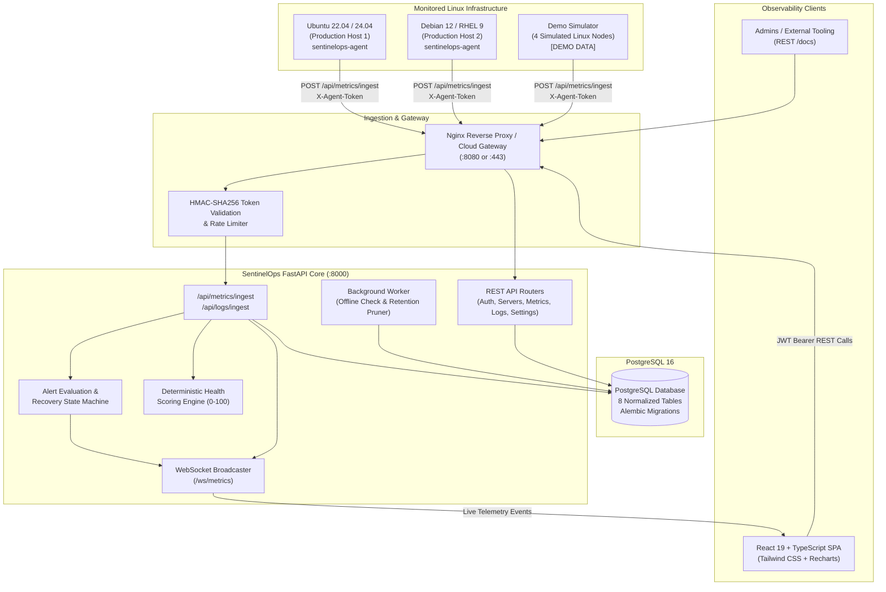
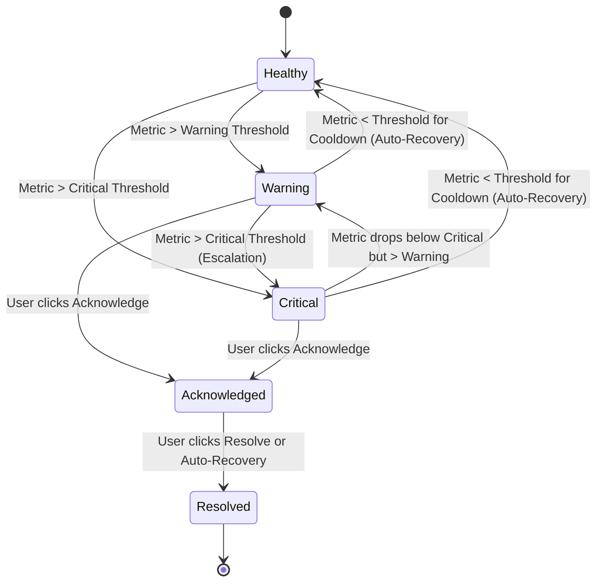

<div align="center">

# 🛡️ SentinelOps
### Enterprise Linux Server Monitoring, Fleet Observability & Alerting Platform

[](https://sentinelops-xp4p.onrender.com/login)
[](https://github.com/Apoorva921/Linux-Server-Monitoring-Management-Platform)
[](https://python.org)
[](https://fastapi.tiangolo.com)
[](https://www.postgresql.org)
[](https://react.dev)
[](https://www.typescriptlang.org)
[](https://tailwindcss.com)
[](https://www.docker.com)
[](LICENSE)

<br/>

**A production-grade, full-stack Linux fleet telemetry and systems management platform designed for systems engineers, SREs, and DevOps teams.**

[🚀 Explore Live Demo](https://sentinelops-xp4p.onrender.com/login) • [📖 Architecture Docs](docs/ARCHITECTURE.md) • [📡 API Reference](docs/API_REFERENCE.md) • [💾 Database Schema](docs/DATABASE_SCHEMA.md) • [🐧 Agent Setup](docs/AGENT_WORKFLOW.md)

</div>

---

## 🌐 Live Production Deployment

SentinelOps is deployed and actively streaming live multi-host Linux telemetry:

| Property | Value |
| :--- | :--- |
| **Live URL** | [**https://sentinelops-xp4p.onrender.com/login**](https://sentinelops-xp4p.onrender.com/login) |
| **Interactive API Docs (Swagger)** | [**https://sentinelops-xp4p.onrender.com/docs**](https://sentinelops-xp4p.onrender.com/docs) |
| **Health Check Endpoint** | [**https://sentinelops-xp4p.onrender.com/health**](https://sentinelops-xp4p.onrender.com/health) |
| **Default Admin Username** | `admin` |
| **Default Admin Password** | `Admin@SentinelOps123!` *(or click the **"Auto-fill Admin Account"** button on the login screen)* |
| **Active Fleet State** | 4 simulated Linux hosts streaming live CPU, memory, disk, network, processes, and logs (`DEMO DATA` labeled) |

---

## 📑 Table of Contents

- [1. Executive Summary](#1-executive-summary)
- [2. Problem Statement & Solution](#2-problem-statement--solution)
- [3. Key Platform Capabilities](#3-key-platform-capabilities)
- [4. High-Level Architecture](#4-high-level-architecture)
- [5. System Components & Technology Stack](#5-system-components--technology-stack)
- [6. Security & Hardening Model](#6-security--hardening-model)
- [7. Deterministic Server Health Scoring](#7-deterministic-server-health-scoring)
- [8. Intelligent Alert Lifecycle Engine](#8-intelligent-alert-lifecycle-engine)
- [9. Database Architecture (8 Normalized Tables)](#9-database-architecture-8-normalized-tables)
- [10. REST API & WebSocket Specifications](#10-rest-api--websocket-specifications)
- [11. Quickstart & Deployment Options](#11-quickstart--deployment-options)
  - [A. One-Click Cloud Blueprint (Render)](#a-one-click-cloud-blueprint-render)
  - [B. Local One-Command Launcher (Windows / Linux)](#b-local-one-command-launcher-windows--linux)
  - [C. Docker Compose (Full Stack)](#c-docker-compose-full-stack)
  - [D. Ubuntu Linux Agent Installation (Production)](#d-ubuntu-linux-agent-installation-production)
- [12. Testing & Quality Assurance](#12-testing--quality-assurance)
- [13. Project Structure](#13-project-structure)
- [14. Production Readiness & Roadmap](#14-production-readiness--roadmap)

---

## 1. Executive Summary

**SentinelOps** is an enterprise-grade infrastructure monitoring and observability platform engineered to deliver end-to-end visibility across distributed Linux fleets. Built on a modular, decoupled architecture, it pairs a lightweight, non-privileged Python collection daemon with a high-throughput **FastAPI** ingestion backend, **PostgreSQL 16** persistence layer, and a modern **React 19** single-page application.

Unlike basic toy dashboards, SentinelOps incorporates real-world systems engineering paradigms: **least-privilege daemon execution**, **rate-of-change network bandwidth calculations**, **transparent deterministic health scoring**, **anti-flapping alert deduplication**, and **real-time bidirectional WebSocket streaming**.

---

## 2. Problem Statement & Solution

| Operational Challenge | How SentinelOps Solves It |
| :--- | :--- |
| **Fragmented Fleet Visibility** | Centralizes multi-server CPU, memory, partition-level disk, and network metrics into a single real-time dashboard. |
| **Alert Notification Storms** | Implements an alert engine with configurable warning/critical thresholds, deduplication, cooldown intervals, and automatic recovery detection. |
| **Misinterpreted Network Counters** | Strictly separates cumulative byte/packet counters from calculated delta throughput (`Bytes/sec` and `Mbps`). |
| **Opaque "AI" Health Scores** | Computes a transparent 0–100 Health Score with deterministic mathematical deduction rules and plain-English factor explanations. |
| **Scattered Host Logs** | Ingests and indexes `/var/log/syslog`, `/var/log/auth.log`, and `journalctl` with keyword search and severity filtering without root-level exploitation. |
| **Security Risks with Remote Management** | Implements HMAC-SHA256 agent authentication, bcrypt password hashing, and role-based access control (Admin vs Viewer), while keeping process termination strictly disabled. |

---

## 3. Key Platform Capabilities

```
┌─────────────────────────────────────────────────────────────────────────────────┐
│                              SENTINELOPS SUITE                                  │
├─────────────────────┬─────────────────────┬───────────────────┬─────────────────┤
│  ⚡ Telemetry Core  │   🚨 Alert Engine   │  📜 Log Explorer  │ 🔐 Security & RBAC│
│  • Per-Core CPU %   │  • Threshold Evals  │  • Syslog Parsing │  • HMAC Token Auth│
│  • Memory Breakdown │  • Auto Escalation  │  • Auth Log Audit │  • JWT Bearer Auth│
│  • Partition Disks  │  • Recovery Detect  │  • Level Filter   │  • Admin / Viewer │
│  • Network Delta    │  • Cooldown Windows │  • Fast Text Search│ • No Root Needed  │
│  • Load Averages    │  • Acknowledge Flow │  • Severities     │  • Rate Limiting  │
└─────────────────────┴─────────────────────┴───────────────────┴─────────────────┘
```

- **Live Fleet Infrastructure Dashboard**: Real-time KPI summaries (total, online, warning, critical, offline hosts), fleet resource averages, and interactive time-series charts using Recharts.
- **Server Lifecycle Management**: Multi-server inventory, host registration, one-time API token generation, token rotation, and comprehensive individual server detail views.
- **Real-Time Telemetry Streaming**: Sub-second metric streaming over `WS /ws/metrics` with automatic exponential backoff reconnection and client-side heartbeat verification.
- **Deterministic Server Health Engine**: Real-time 0–100 health scoring based on weighted multi-resource utilization and active alert penalties with granular deduction breakdowns.
- **System Log Aggregator**: Structured log ingestion from `/var/log/syslog`, `/var/log/auth.log`, and `journalctl` with search, severity filtering, and visual error/warning highlighting.
- **Live Process Explorer**: Read-only process inspection (`PID`, `user`, `status`, `%CPU`, `%Memory`) with instant search and multi-column sorting.
- **Dual Operating Modes**:
  - **Mode A (Production)**: Real Linux servers running the hardened `sentinelops-agent` daemon.
  - **Mode B (Demo Simulation)**: 4 simulated Linux hosts streaming realistic workloads, spikes, and syslog events—all strictly labeled `DEMO DATA`.

---

## 4. High-Level Architecture



---

## 5. System Components & Technology Stack

### Backend API Server
- **Framework**: [FastAPI](https://fastapi.tiangolo.com) (Python 3.11+) with ASGI server [Uvicorn](https://www.uvicorn.org).
- **Validation & Models**: [Pydantic v2](https://docs.pydantic.dev) with strict type hints and comprehensive payload validation.
- **ORM & Database Driver**: [SQLAlchemy 2.0](https://www.sqlalchemy.org) with [Alembic](https://alembic.sqlalchemy.org) migrations and `psycopg` (PostgreSQL 16).
- **Authentication**: JWT access tokens (HMAC-SHA256 via `PyJWT`), password hashing via `bcrypt`, and per-server agent API tokens hashed with SHA-256.
- **Real-Time Communication**: Native asynchronous WebSockets with topic multiplexing and client heartbeat ping/pong.

### Frontend Web Dashboard
- **Core**: [React 19](https://react.dev) + [TypeScript 5.5+](https://www.typescriptlang.org) bundled with [Vite](https://vitejs.dev).
- **Styling**: [Tailwind CSS v4](https://tailwindcss.com) with custom light pastel accents (`#F7F8FC` canvas, emerald, amber, rose, violet, and sky badges).
- **Visualizations**: [Recharts](https://recharts.org) for responsive CPU, memory, disk, and network throughput charts.
- **Icons & Routing**: [Lucide React](https://lucide.dev) & [React Router v6](https://reactrouter.com).
- **Testing**: [Vitest](https://vitest.dev) & [React Testing Library](https://testing-library.com).

### Monitoring Agent Daemon
- **Language**: Python 3.9+ with `psutil` cross-platform system telemetry.
- **Data Extracted**:
  - CPU: aggregate %, per-core %, user, system, iowait breakdown.
  - Memory: total, available, used, cached, swap % and MB.
  - Disk: per-partition mount point, fstype, total, used, free, utilization %.
  - Network: cumulative sent/recv bytes and packets, interface identification, calculated transfer rate (`B/s` and `Mbps`).
  - System: load averages (1m, 5m, 15m), uptime, hostname, IP address, OS release, kernel version.
  - Processes: top CPU/memory processes with PID, user, status, and resource shares.
  - Logs: read-only tailing of `/var/log/syslog`, `/var/log/auth.log`, and `journalctl`.

---

## 6. Security & Hardening Model

SentinelOps is built according to **defense-in-depth** and **least-privilege** systems engineering standards:

```
┌────────────────────────────────────────────────────────────────────────┐
│                        SECURITY ARCHITECTURE                           │
├──────────────────────────┬─────────────────────────────────────────────┤
│ Credential Protection    │ Passwords hashed with bcrypt (salt rounds).  │
│                          │ Agent tokens stored as SHA-256 digests.     │
│ RBAC Enforcement         │ Role-based access: Admin (write/delete) vs  │
│                          │ Viewer (read-only telemetry & logs).        │
│ Non-Root Execution       │ Agent runs under dedicated 'sentinelops'    │
│                          │ system user in 'adm'/'systemd-journal' group│
│ Read-Only Process Policy │ Process termination/kill is intentionally   │
│                          │ disabled to prevent remote code execution.  │
│ Strict Rate Limiting     │ Auth & ingestion endpoints protected by     │
│                          │ sliding-window rate limiters.               │
│ Network Isolation        │ Database never directly exposed; all agent  │
│                          │ communication authenticated via HTTP/WS.    │
└──────────────────────────┴─────────────────────────────────────────────┘
```

---

## 7. Deterministic Server Health Scoring

Instead of opaque machine learning heuristics, SentinelOps implements an **auditable, deterministic health scoring formula** that outputs an integer from `0` to `100`:

$$\text{Health Score} = 100 - \sum \text{Deductions}$$

### Deduction Criteria

| Metric | Condition | Deduction Points |
| :--- | :--- | :--- |
| **Server Offline** | Heartbeat older than 30s | **-100 pts** (Score: 0) |
| **CPU Usage** | $\ge 90\%$ (Critical) | **-20 pts** |
| **CPU Usage** | $75\% \le \text{CPU} < 90\%$ (Warning) | **-10 pts** |
| **Memory Usage** | $\ge 90\%$ (Critical) | **-20 pts** |
| **Memory Usage** | $80\% \le \text{RAM} < 90\%$ (Warning) | **-10 pts** |
| **Disk Usage** | $\ge 90\%$ (Critical) | **-20 pts** |
| **Disk Usage** | $80\% \le \text{Disk} < 90\%$ (Warning) | **-10 pts** |
| **Active Critical Alerts** | Per open critical alert | **-15 pts** (max 30) |
| **Active Warning Alerts** | Per open warning alert | **-5 pts** (max 15) |

Every server in the UI displays a detailed breakdown of its exact deductions (e.g. `100 - 10 (RAM 84%) - 10 (Disk 82%) = 80/100`).

---

## 8. Intelligent Alert Lifecycle Engine

SentinelOps prevents alert notification fatigue through an automated state machine:



- **Deduplication**: Active alerts for the same server and rule are not re-created on each collection tick.
- **Escalation**: Existing `warning` alerts auto-escalate to `critical` when utilization spikes further.
- **Cooldown Window**: Prevents flapping when utilization oscillates around threshold boundaries.
- **Auto-Recovery**: When metrics return to normal, active alerts automatically transition to `resolved` with a recovery log entry.

---

## 9. Database Architecture (8 Normalized Tables)

SentinelOps uses 8 third-normal-form PostgreSQL tables managed by Alembic:

```
┌─────────────────┐       ┌─────────────────┐       ┌─────────────────┐
│      users      │       │     servers     │──────<│  agent_tokens   │
│  (id, role,     │       │ (id, hostname,  │       │(id, token_hash, │
│   bcrypt_hash)  │       │  status, score) │       │ is_active)      │
└─────────────────┘       └────────┬────────┘       └─────────────────┘
                                   │
         ┌─────────────────────────┼─────────────────────────┐
         │                         │                         │
         ▼                         ▼                         ▼
┌─────────────────┐       ┌─────────────────┐       ┌─────────────────┐
│ server_metrics  │       │     alerts      │       │   system_logs   │
│ (time, cpu,     │       │(id, rule_id,    │       │(id, severity,   │
│  ram, disk, net)│       │ severity, state)│       │ source, message)│
└─────────────────┘       └────────▲────────┘       └─────────────────┘
                                   │
                          ┌────────┴────────┐       ┌─────────────────┐
                          │   alert_rules   │       │ system_settings │
                          │(metric, warning,│       │(retention_days, │
                          │ critical, cool) │       │ interval, etc)  │
                          └─────────────────┘       └─────────────────┘
```

1. **`users`**: Identity, email, password hash, role (`admin` / `viewer`), activity status.
2. **`servers`**: Host metadata, display name, IP, OS info, last heartbeat, status, health score, demo flag.
3. **`agent_tokens`**: Per-server SHA-256 hashed API tokens with one-time display prefixes and revocation timestamps.
4. **`server_metrics`**: Time-series CPU, RAM, swap, disk partitions, network counters/rates, load averages, processes.
5. **`alert_rules`**: Global and per-server configurable warning/critical thresholds and cooldown durations.
6. **`alerts`**: Alert records with severity, current value, acknowledgement state, and resolution timestamps.
7. **`system_logs`**: Ingested syslog, auth.log, and journald entries indexed by server, timestamp, and severity.
8. **`system_settings`**: Global configuration for collection intervals, retention pruning, and default thresholds.

---

## 10. REST API & WebSocket Specifications

### Authentication & Users
- `POST /api/auth/register` — Create initial administrator or viewer accounts.
- `POST /api/auth/login` — Authenticate and receive signed JWT access token.
- `GET /api/auth/me` — Retrieve current authenticated user profile and role.

### Fleet & Servers
- `GET /api/servers` — List registered servers with status, health score, and filtering (`is_demo`, `status`).
- `POST /api/servers/register` — Register a new host and receive a one-time agent API token.
- `GET /api/servers/{id}` — Retrieve detailed host metadata, partition list, and health breakdown.
- `POST /api/servers/{id}/rotate-token` — Revoke and generate a new agent API token.
- `DELETE /api/servers/{id}` — Unregister server and prune associated historical records.

### Telemetry & Ingestion
- `POST /api/metrics/ingest` — Ingest host metrics (`X-Agent-Token` authenticated).
- `GET /api/servers/{id}/metrics` — Retrieve latest point-in-time metrics for a host.
- `GET /api/servers/{id}/metrics/history` — Time-series metric history for custom ranges (`15m`, `1h`, `6h`, `24h`, `7d`).
- `GET /api/servers/{id}/processes` — Retrieve latest running process snapshot.

### Alerts & Logs
- `GET /api/alerts` — Query alerts filtered by severity, status, and server.
- `PATCH /api/alerts/{id}/acknowledge` — Mark active alert as acknowledged.
- `PATCH /api/alerts/{id}/resolve` — Manually resolve an alert.
- `POST /api/logs/ingest` — Ingest structured syslog/auth.log entries.
- `GET /api/logs` — Query aggregated system logs with multi-parameter filtering.

### Real-Time WebSockets
- `WS /ws/metrics` — Bi-directional WebSocket stream for live fleet-wide metrics and alert broadcasts.

---

## 11. Quickstart & Deployment Options

### A. One-Click Cloud Blueprint (Render)

SentinelOps includes a pre-configured [`render.yaml`](render.yaml) blueprint:

1. Fork or clone this repository to your GitHub account:
   ```bash
   git clone https://github.com/Apoorva921/Linux-Server-Monitoring-Management-Platform.git
   ```
2. Open [Render.com Blueprints](https://dashboard.render.com/blueprints).
3. Connect your repository. Render automatically reads `render.yaml` and provisions:
   - A managed **PostgreSQL 16** database (`sentinelops-db`).
   - A multi-stage **Docker Web Service** (`sentinelops`) running the React SPA + FastAPI backend.
4. Click **Apply**. Within 3 minutes, your live production URL is ready!

---

### B. Local One-Command Launcher (Windows / Linux)

For local development without Docker, use the included one-click launcher scripts:

#### Windows (PowerShell or Command Prompt):
```powershell
# Starts PostgreSQL (or SQLite fallback), installs dependencies, runs migrations, and launches Demo Mode
.\start.ps1
```
*(Or double-click `start.bat`)*

#### Linux / macOS:
```bash
chmod +x scripts/cloud_entrypoint.sh
./scripts/cloud_entrypoint.sh
```

Open `http://localhost:8000` in your browser.

---

### C. Docker Compose (Full Stack)

To run the complete production container stack locally:

```bash
# Clone the repository
git clone https://github.com/Apoorva921/Linux-Server-Monitoring-Management-Platform.git
cd Linux-Server-Monitoring-Management-Platform

# Configure environment
cp .env.example .env

# Launch in Mode A (Real Linux Hosts):
docker compose up --build

# Or launch in Mode B (Demo Mode with 4 Simulated Hosts):
docker compose --profile demo up --build
```

**Services launched**:
- Frontend SPA: `http://localhost:8080`
- Backend API Docs: `http://localhost:8080/docs`
- Health Endpoint: `http://localhost:8080/health`
- PostgreSQL 16: `localhost:5432`

---

### D. Ubuntu Linux Agent Installation (Production)

To connect a real Ubuntu or Debian server to your SentinelOps instance:

1. Sign in to your SentinelOps dashboard (`admin` / `Admin@SentinelOps123!`).
2. Navigate to **Servers → Register Agent**, enter the hostname, and copy the generated `SERVER_ID` and `API_TOKEN`.
3. On the target Linux machine, execute the hardened installer script:
   ```bash
   sudo bash scripts/install_agent_ubuntu.sh \
     --api-url https://sentinelops-xp4p.onrender.com \
     --server-id <YOUR_SERVER_UUID> \
     --api-token <YOUR_AGENT_API_TOKEN>
   ```
4. Verify the systemd service status:
   ```bash
   sudo systemctl status sentinelops-agent
   journalctl -u sentinelops-agent -f
   ```

The agent runs as a dedicated `sentinelops` user with least-privilege permissions and automatically restarts on reboot.

---

## 12. Testing & Quality Assurance

SentinelOps maintains automated test coverage across all layers of the stack:

```
┌────────────────────────────────────────────────────────────────────────┐
│                        AUTOMATED TEST SUITE                            │
├─────────────────────┬───────────────────┬──────────────┬───────────────┤
│ Layer               │ Framework         │ Tests        │ Status        │
├─────────────────────┼───────────────────┼──────────────┼───────────────┤
│ Backend APIs & RBAC │ Pytest + TestClient│ 15 Passed    │ ✅ Verified   │
│ Agent Collectors    │ Pytest            │ 2 Passed     │ ✅ Verified   │
│ Frontend Dashboard  │ Vitest + RTL      │ 4 Passed     │ ✅ Verified   │
│ TypeScript Types    │ tsc (Vite Build)  │ 0 Errors     │ ✅ Clean      │
│ End-to-End Smoke    │ Automated E2E     │ 5/5 Passed   │ ✅ Production │
└─────────────────────┴───────────────────┴──────────────┴───────────────┘
```

### Running the Test Suites

```bash
# 1. Run Backend Unit & Integration Tests (15 tests)
cd backend
pytest tests -v

# 2. Run Agent Collector Tests (2 tests)
cd ../monitoring-agent
pytest tests -v

# 3. Run Frontend Unit Tests (4 tests)
cd ../frontend
npm test

# 4. Verify TypeScript Production Build
npm run build

# 5. Run Full End-to-End Smoke Test
cd ..
python scripts/verify_e2e.py
```

---

## 13. Project Structure

```
Linux-Server-Monitoring-Management-Platform/
├── backend/                        # FastAPI High-Throughput REST & WebSocket Core
│   ├── alembic/                    # Database Migrations & Version Control
│   ├── app/
│   │   ├── api/                    # Modular Routers (auth, servers, metrics, alerts, logs, settings)
│   │   ├── core/                   # Security, JWT, HMAC hashing, Settings, DB session
│   │   ├── models/                 # SQLAlchemy 2.0 ORM Table Declarations
│   │   ├── schemas/                # Pydantic v2 Input/Output Contract Schemas
│   │   └── services/               # Health Scoring, Alert State Machine, WebSockets
│   ├── tests/                      # Automated Pytest Suite (Auth, Ingestion, RBAC, Scoring)
│   └── requirements.txt
├── frontend/                       # Modern React 19 + TypeScript SPA
│   ├── src/
│   │   ├── components/             # Reusable UI Widgets, Navigation, StatCards, Modals
│   │   ├── pages/                  # Overview, Servers, Server Detail, Monitoring, Alerts, Logs, Settings
│   │   ├── services/               # Axios API client, WebSocket manager, Auth Context
│   │   ├── types/                  # TypeScript Data Models
│   │   └── utils/                  # Deterministic Health Scoring & Data Formatters
│   ├── package.json
│   └── vite.config.ts
├── monitoring-agent/               # Hardened Python System Telemetry Daemon
│   ├── collectors/                 # CPU, Memory, Disk, Network, System, Process Collectors
│   ├── log_collectors/             # Syslog, Auth.log, Journald Readers
│   ├── agent.py                    # Main Ingestion Agent Loop
│   ├── demo_simulator.py           # Multi-Host Simulation Daemon (Mode B)
│   └── tests/                      # Collector Unit Tests
├── scripts/                        # Production Automation Scripts
│   ├── cloud_entrypoint.sh         # Docker Cloud Entrypoint with Migrations & Demo Startup
│   ├── install_agent_ubuntu.sh     # Hardened Ubuntu systemd Agent Installer
│   ├── verify_e2e.py               # End-to-End Verification Pipeline
│   └── check_live.py               # Cloud Health & Verification Probe
├── docs/                           # Technical Specifications & Documentation
│   ├── ARCHITECTURE.md             # In-Depth System Design & Topology
│   ├── API_REFERENCE.md            # Comprehensive REST & WebSocket Spec
│   ├── DATABASE_SCHEMA.md          # 8-Table ER Diagram & Index Strategy
│   └── AGENT_WORKFLOW.md           # Agent Security, Collection & Protocol
├── Dockerfile                      # Production Multi-Stage Container (React + FastAPI)
├── docker-compose.yml              # Multi-Service Production Compose File
├── render.yaml                     # Render Blueprint Deployment Configuration
├── start.ps1                       # One-Click Windows PowerShell Launcher
├── start.bat                       # One-Click Windows Batch Launcher
└── README.md                       # Enterprise Technical Documentation
```

---

## 14. Production Readiness & Roadmap

- [x] Multi-host system metrics collection with `psutil`
- [x] Calculated rate-of-change network bandwidth throughput
- [x] JWT Bearer authentication with Role-Based Access Control (`admin` vs `viewer`)
- [x] HMAC-SHA256 hashed agent tokens
- [x] Anti-flapping alert state machine with escalation and auto-recovery
- [x] Transparent deterministic 0–100 health scoring engine
- [x] Real-time bi-directional WebSocket telemetry streaming
- [x] Automated database migrations with Alembic
- [x] One-click Docker containerization and Render Blueprint deployment
- [x] Live cloud deployment actively verified on Render Cloud
- [ ] TimescaleDB hypertable compression for 10,000+ host fleets
- [ ] External alert dispatchers (Slack, PagerDuty, Email Webhooks)
- [ ] Mutual TLS (mTLS) certificate-based agent authentication

---

## 📄 License

This project is licensed under the MIT License — see the [LICENSE](LICENSE) file for details.

<div align="center">
<sub>Built with precision for Linux infrastructure observability. Designed and maintained by the SentinelOps Engineering Team.</sub>
</div>
