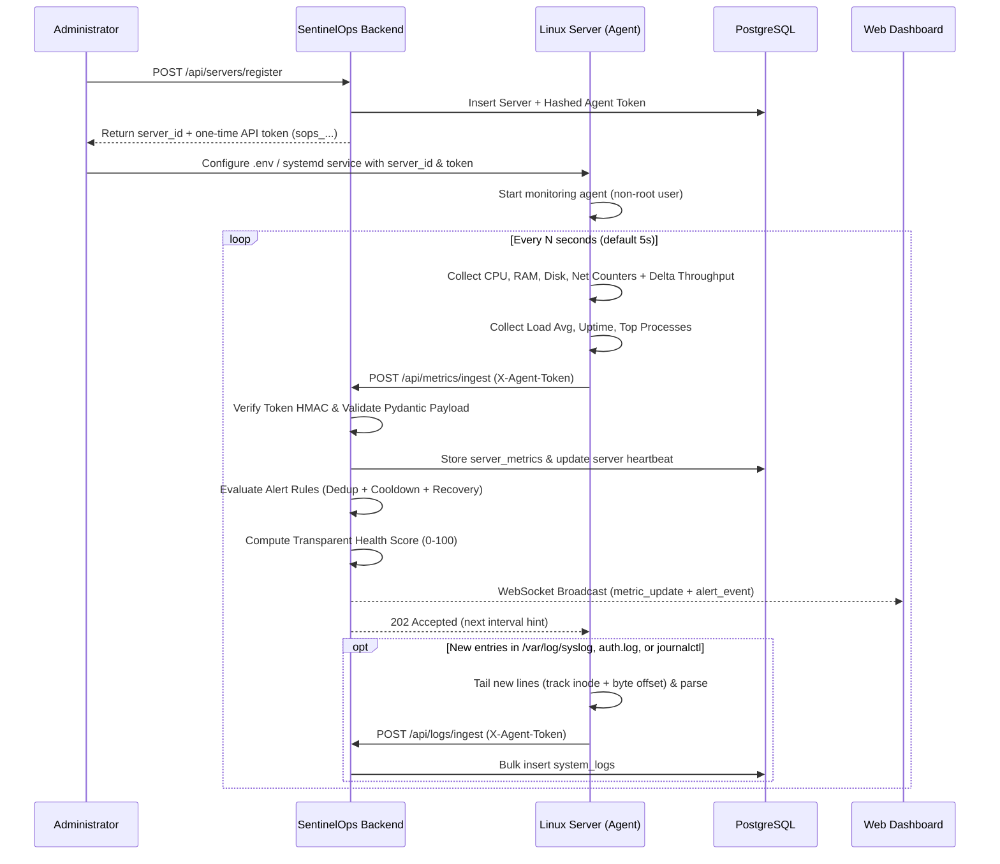

# SentinelOps Monitoring Agent Workflow

## Agent Lifecycle & Collection Pipeline

## Security Principles

1. **Least Privilege**: Runs under dedicated `sentinelops` Linux user with read-only membership in `adm` and `systemd-journal`. Never runs as `root`.
2. **No Remote Command Execution**: The agent is strictly push-only (outbound HTTPS/HTTP POST). It opens zero listening ports and executes no user-supplied shell commands.
3. **Graceful Degradation**: If `/var/log/auth.log` or `journalctl` is unreadable due to OS permissions, the agent logs a warning once and continues collecting metrics without attempting privilege escalation.
4. **Retry & Backoff**: Transient network errors trigger exponential backoff up to 60 seconds without crashing the agent daemon.

