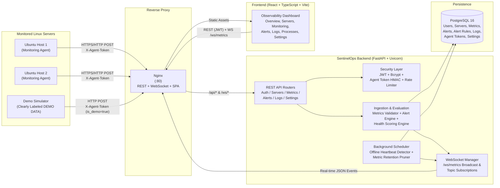

# SentinelOps System Architecture

## 1. Overview

**SentinelOps** is a centralized, production-style Linux server monitoring and observability platform. It separates metric/log collection (edge monitoring agents) from ingestion, persistence, threshold evaluation, health scoring, and real-time visualization (central platform).

## 2. High-Level Architecture Diagram

## 3. Architectural Components

### A. Linux Monitoring Agent (`monitoring-agent/`)
- Runs as a lightweight, non-root `systemd` service (`sentinelops` user) on each monitored Ubuntu/Linux host.
- Uses modular collectors (`cpu`, `memory`, `disk`, `network`, `processes`, `system`, `logs`) built on `psutil`, `/proc` filesystems, `/etc/os-release`, and restricted read-only access to `/var/log/syslog`, `/var/log/auth.log`, and `journalctl`.
- Computes **network throughput (bytes/sec)** accurately from successive cumulative counter deltas rather than confusing cumulative counters with live throughput.
- Authenticates every request with a per-server API token (`X-Agent-Token` header) issued once during server registration.
- Tracks file inodes and byte offsets for log tailing to prevent duplicate log ingestion and handle log rotation cleanly.

### B. FastAPI Backend (`backend/`)
- **Modular separation**: `core/` (config, security, rate limiting, logging), `database/` (SQLAlchemy engine, session management, Alembic migrations), `models/` (ORM entities), `schemas/` (Pydantic v2 contracts), `services/` (health scoring, alert evaluation, metrics ingestion, log parsing, retention), `api/` (versioned REST routers), `websocket/` (connection manager & topic fan-out).
- **Deterministic Health Scoring Engine**: Computes a transparent 0–100 score from CPU, memory, disk, server availability, and active alert severity, returning explicit factor-by-factor deductions.
- **Stateful Alert Engine**: Evaluates incoming metrics against per-server or global `alert_rules`. Implements deduplication (no alert storms every 5s), severity escalation (`warning` → `critical`), cooldown suppression after resolution, and automatic recovery detection.
- **Real-time WebSocket Pipeline**: Authenticated via JWT query parameter; broadcasts live metric updates, alert transitions, and server online/offline status changes to subscribed clients without polling.

### C. PostgreSQL Persistence
- Normalized schema across 8 tables (`users`, `servers`, `agent_tokens`, `server_metrics`, `alert_rules`, `alerts`, `system_logs`, `system_settings`).
- All timestamps stored as timezone-aware UTC (`TIMESTAMP WITH TIME ZONE`).
- Composite indexes on `(server_id, timestamp DESC)` for fast time-series queries and `(server_id, status, severity)` for alert queries.
- Automated retention pruning removes metrics and logs older than `metric_retention_days`.

### D. React + TypeScript Frontend (`frontend/`)
- Dark, observability-grade UI inspired by Datadog/Grafana/Linear.
- Communicates exclusively via typed Axios REST client and a resilient `useMetricsWebSocket` hook with exponential backoff reconnection, heartbeat tracking, and deduplicated server subscriptions.
- Role-based UI gating (`admin` vs `viewer`) mirrored by backend authorization checks.
- Prominent **`DEMO DATA`** badges whenever a server, metric, alert, or log originates from the Demo Simulator (`is_demo: true`).

## 4. Key Architectural Decisions

1. **Direct `bcrypt` + `PyJWT` over legacy wrappers**: Ensures full compatibility with Python 3.11–3.13+ without deprecated dependencies.
2. **Hashed Agent Tokens (HMAC-SHA256) with Display Prefix**: Agent tokens are generated via `secrets.token_urlsafe(32)`, shown once at registration, and stored only as `token_prefix` + HMAC-SHA256 digest verified with `hmac.compare_digest`.
3. **Simulator Uses Real API Pipeline**: Instead of mocking frontend charts or bypassing the backend, the demo simulator acts as real authenticated agents pushing `is_demo=true` payloads through `/api/metrics/ingest` and `/api/logs/ingest`, exercising the entire backend stack end-to-end.
4. **Least-Privilege Agent Design**: No arbitrary remote command execution endpoints; process monitoring is strictly read-only; log reading never elevates privileges or shells out to user-supplied strings.

