# SentinelOps Database Schema

## Entity-Relationship Diagram

```mermaid
erDiagram
    users ||--o{ alerts : "acknowledges"
    servers ||--o{ agent_tokens : "authenticates_with"
    servers ||--o{ server_metrics : "records"
    servers ||--o{ alerts : "triggers"
    servers ||--o{ system_logs : "emits"
    servers ||--o{ alert_rules : "overrides"
    alert_rules ||--o{ alerts : "generates"

    users {
        uuid id PK
        varchar username UK
        varchar email UK
        varchar hashed_password
        varchar full_name
        varchar role "admin | viewer"
        boolean is_active
        timestamptz created_at
        timestamptz updated_at
    }

    servers {
        uuid id PK
        varchar hostname
        varchar display_name
        varchar ip_address
        varchar os_name
        varchar os_version
        varchar kernel_version
        varchar architecture
        int cpu_cores
        float total_memory_mb
        float total_disk_gb
        varchar agent_version
        varchar status "healthy | warning | critical | offline"
        float health_score
        json health_explanation
        bigint uptime_seconds
        float load_avg_1m
        float load_avg_5m
        float load_avg_15m
        timestamptz last_heartbeat
        boolean is_demo
        json tags
        timestamptz created_at
        timestamptz updated_at
    }

    agent_tokens {
        uuid id PK
        uuid server_id FK
        varchar token_prefix
        varchar token_hash UK
        varchar name
        boolean is_active
        timestamptz last_used_at
        timestamptz created_at
        timestamptz revoked_at
    }

    server_metrics {
        bigint id PK
        uuid server_id FK
        timestamptz timestamp
        float cpu_percent
        float cpu_user
        float cpu_system
        float cpu_iowait
        float memory_percent
        float memory_used_mb
        float memory_available_mb
        float memory_total_mb
        float swap_percent
        float disk_percent
        float disk_used_gb
        float disk_total_gb
        json disk_partitions
        bigint net_bytes_sent
        bigint net_bytes_recv
        bigint net_packets_sent
        bigint net_packets_recv
        varchar net_interface
        float net_upload_bps
        float net_download_bps
        float load_1m
        float load_5m
        float load_15m
        bigint uptime_seconds
        int process_count
        json top_processes
        boolean is_demo
    }

    alert_rules {
        uuid id PK
        uuid server_id FK "nullable (null = global)"
        varchar name
        varchar metric_type "cpu | memory | disk | network_upload | network_download"
        float warning_threshold
        float critical_threshold
        int cooldown_seconds
        boolean is_enabled
        timestamptz created_at
        timestamptz updated_at
    }

    alerts {
        uuid id PK
        uuid server_id FK
        uuid rule_id FK "nullable"
        varchar metric_type
        varchar title
        text description
        varchar severity "warning | critical | info"
        float metric_value
        float threshold_value
        varchar status "active | acknowledged | resolved"
        uuid acknowledged_by FK "nullable"
        timestamptz acknowledged_at
        timestamptz resolved_at
        boolean is_demo
        timestamptz created_at
        timestamptz updated_at
    }

    system_logs {
        bigint id PK
        uuid server_id FK
        timestamptz timestamp
        varchar severity "DEBUG | INFO | WARNING | ERROR | CRITICAL"
        varchar source
        varchar hostname
        text message
        text raw_line
        boolean is_demo
        timestamptz created_at
    }

    system_settings {
        int id PK
        int monitoring_interval_seconds
        int offline_threshold_seconds
        int metric_retention_days
        json log_sources
        boolean enable_journalctl
        int max_processes_per_snapshot
        timestamptz updated_at
    }
```

## Key Indexing & Retention Strategy

1. **Time-series performance**: `server_metrics` has a composite index `ix_server_metrics_server_ts` on `(server_id, timestamp DESC)`.
2. **Log search performance**: `system_logs` has composite indexes on `(server_id, timestamp DESC)` and `(severity, timestamp DESC)`.
3. **Alert deduplication performance**: `alerts` has a composite index on `(server_id, metric_type, status)`.
4. **Retention policy**: A background task prunes `server_metrics` and `system_logs` older than `system_settings.metric_retention_days` (default 30 days).
5. **UTC timestamps**: All datetime columns store timezone-aware UTC values.

